# Azure Administration Lab (AZ-104 Skills)

Hands-on lab built in the Azure portal to practise the skills from the **Microsoft Azure Administrator (AZ-104)** certification.
Everything was deployed into one resource group, `rg-az104-lab`, and tagged `project : az104-lab`.

**Author:** Mohammed Junaid. Microsoft Certified: Azure Administrator Associate (AZ-104) and Oracle OCI Architect Associate.

---

## What I built

| Area | What I did |
|---|---|
| Cost management | Monthly budget with actual and forecast email alerts |
| Governance | Resource group with tags, Azure Policy "Require a tag on resources", delete lock |
| Identity & access | Entra ID user and security group, Reader role (RBAC) on the resource group |
| Storage | StorageV2 account (LRS), private blob container, test upload |
| Networking | VNet `10.10.0.0/16` with two subnets, NSG with HTTP and restricted SSH rules |
| Compute | Ubuntu VM in Central India running **nginx**, plus a data disk |
| Monitoring | Log Analytics workspace, CPU > 80% metric alert, email action group |
| Backup | Recovery Services vault, VM backup with a successful restore point |

---

## 1. Cost management: budget
Created a monthly budget (`budget-az104`) with email alerts at 80% of actual cost and 50% of forecast cost, so spending is tracked from day one.

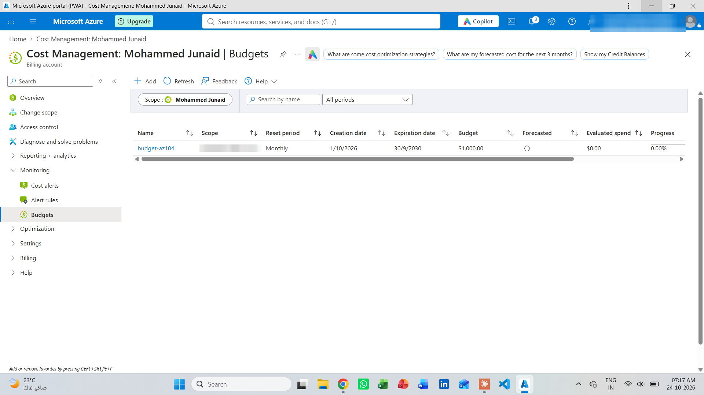

## 2. Resource group and tags
Created `rg-az104-lab` with the tag `project : az104-lab`. The same tag was applied to every resource in the lab.

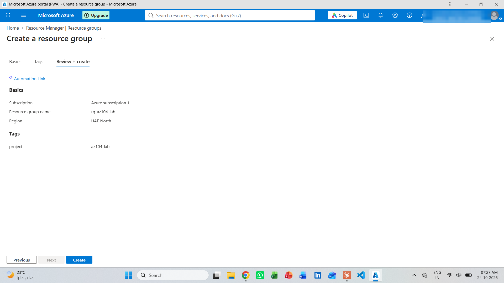

## 3. Entra ID user and group
Created a test user (`Lab User1`) and a security group (`grp-lab-readers`), then added the user to the group.

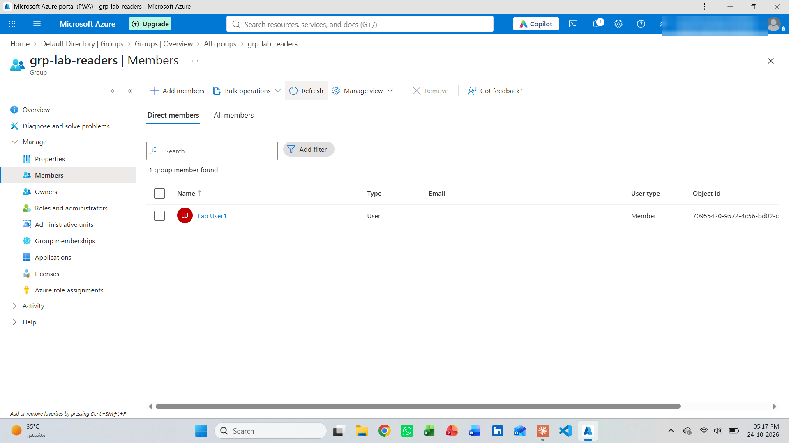

## 4. RBAC role assignment
Gave `grp-lab-readers` the **Reader** role on the resource group. Access is granted to the group instead of to each user.

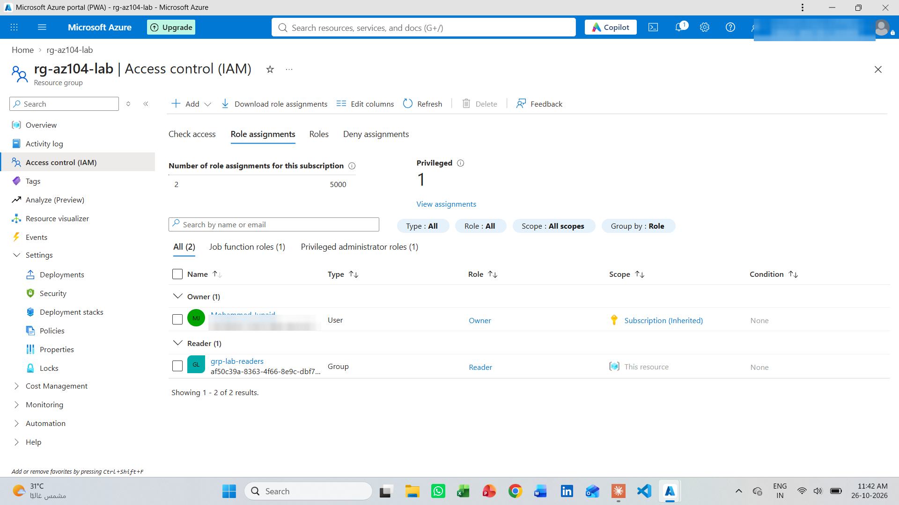

## 5. Azure Policy
Assigned the built-in policy **Require a tag on resources** (tag name: `project`) to the resource group in Deny mode.

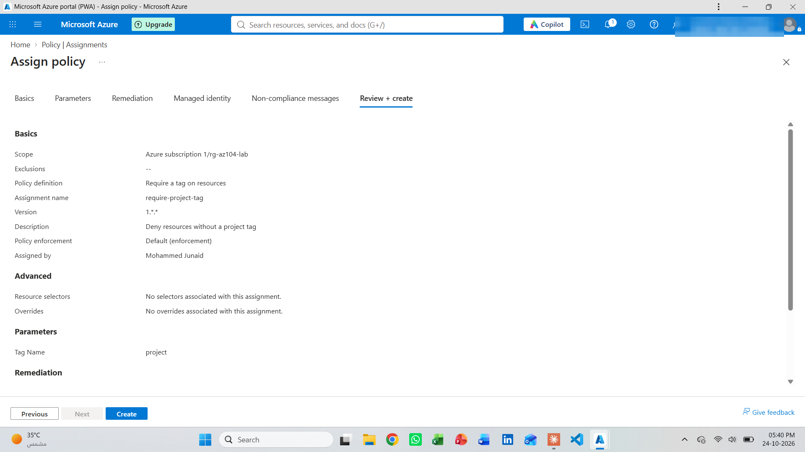

## 6. Policy in action
When I tried to add a data disk without the `project` tag, Azure **blocked the deployment** because of the policy. After I added the tag, the disk was created.

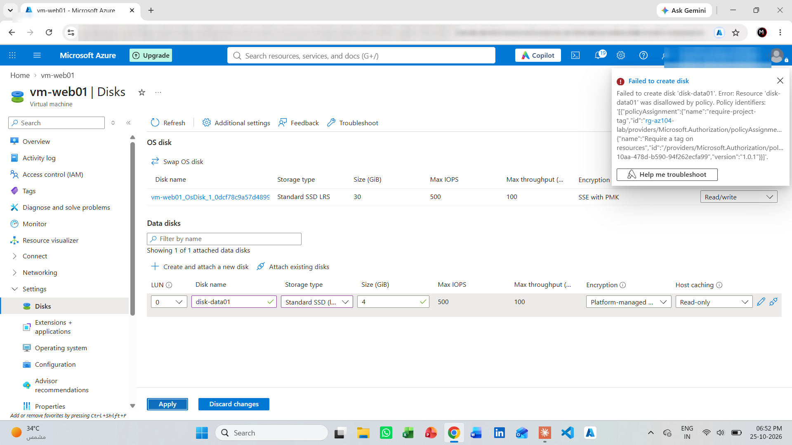

## 7. Resource lock
Added a **Delete** lock (`lock-nodelete`) on the resource group so nobody can delete it by mistake.

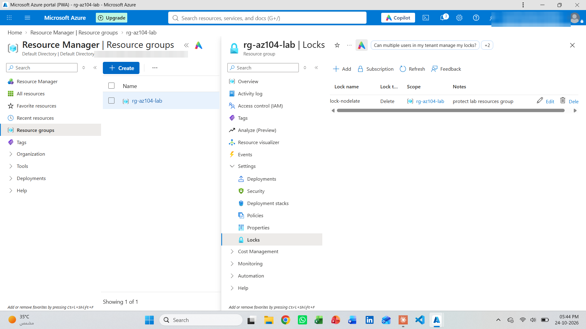

## 8. Storage account
Created storage account `staz104junaid01` (StorageV2, Standard, LRS, TLS 1.2 minimum, anonymous blob access disabled). Then I created a private container `docs` and uploaded a test file.

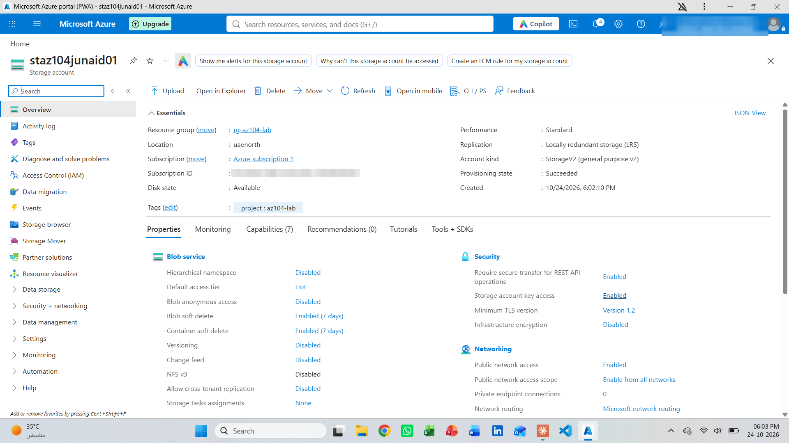

## 9. Virtual network
Created `vnet-az104` (`10.10.0.0/16`) with two subnets: `snet-web` (`10.10.1.0/24`) and `snet-app` (`10.10.2.0/24`).

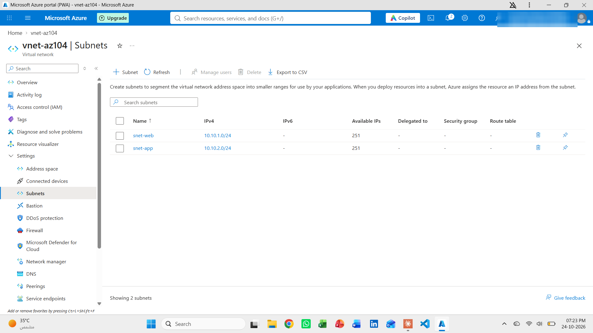

## 10. Network Security Group
Created `nsg-web` and associated it with `snet-web`:
- `allow-http`: TCP 80 from anywhere
- `allow-ssh-myip`: TCP 22 **from my own public IP only**, not open to the internet

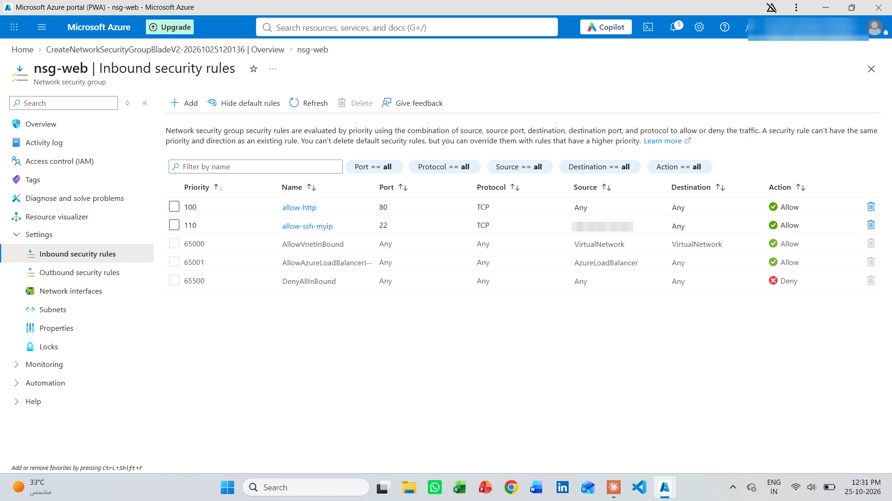

## 11. Linux VM with nginx
Deployed an Ubuntu VM (`vm-web01`) in Central India, connected over SSH, installed nginx and published a custom page.

```bash
sudo apt update && sudo apt install -y nginx
echo "<h1>AZ-104 Lab - Mohammed</h1>" | sudo tee /var/www/html/index.html
systemctl status nginx --no-pager
```

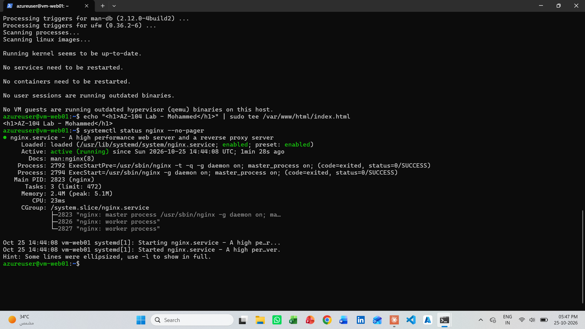

The page loads in a browser through the VM's public IP:

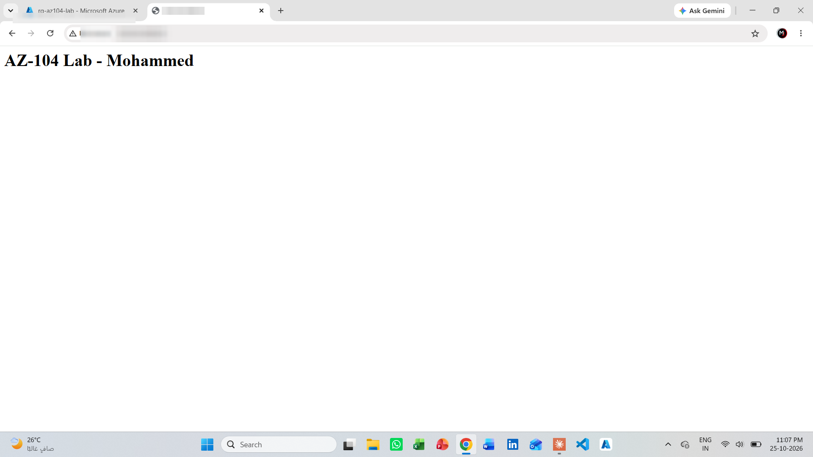

## 12. Monitoring
Created a Log Analytics workspace (`law-az104`), a metric alert rule (`alert-cpu-80`, CPU above 80%) and an action group (`ag-az104-email`) that sends an email.

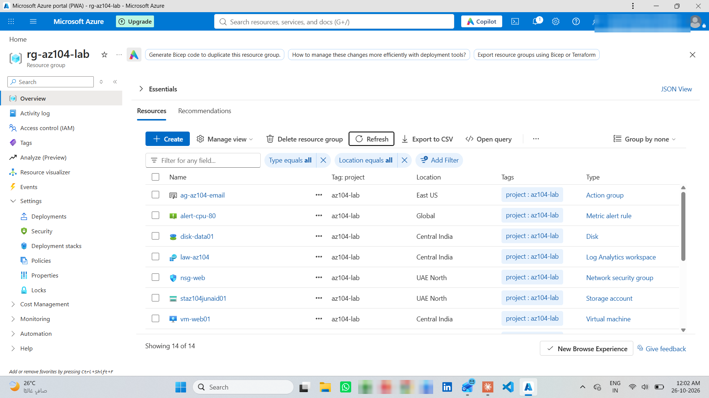

## 13. Backup
Created a Recovery Services vault (`rsv-az104`), enabled backup for `vm-web01` using the Enhanced policy and ran **Backup now**. The backup completed successfully and created a restore point.

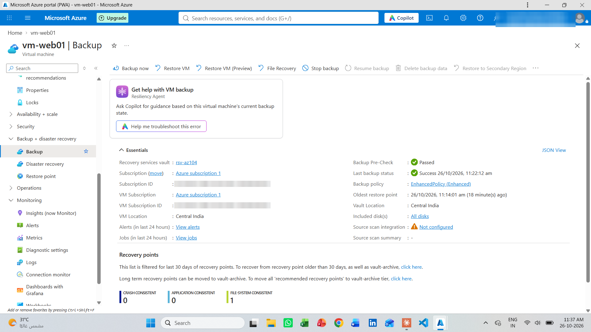

## 14. Cleanup
To avoid charges after the lab:
1. Remove the `lock-nodelete` lock (a delete lock blocks deletion, even for the Owner).
2. Stop backup and delete the backup data in the vault.
3. Delete the resource group `rg-az104-lab`.

---

## Key lessons
- **Policy works before deployment.** The tag policy stopped an untagged disk immediately, which is how governance is enforced in real environments.
- **A lock blocks even the Owner.** The lock must be removed before the resource group can be deleted.
- **Never open SSH to the whole internet.** Limiting port 22 to one IP is a simple, strong control.
- **Assign roles to groups, not users.** Access stays easy to manage as people join or leave.

## Skills
Azure Portal · Microsoft Entra ID · RBAC · Azure Policy · Resource Locks · Tags · Cost Management · Storage Accounts · Virtual Networks · NSG · Linux (Ubuntu) · nginx · SSH · Azure Monitor · Log Analytics · Azure Backup
